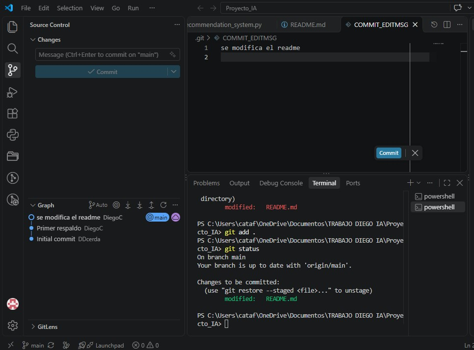
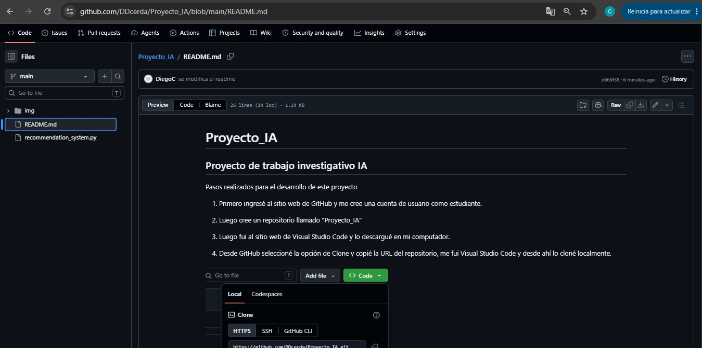

# Proyecto_IA
## Proyecto de trabajo investigativo IA

Pasos realizados para el desarrollo de este proyecto
1. Primero ingresé al sitio web de GitHub y me cree una cuenta de usuario como estudiante.

2. Luego cree un repositorio llamado "Proyecto_IA"

3. Luego fui al sitio web de Visual Studio Code y lo descargué en mi computador.

4. Desde GitHub seleccioné la opción de Clone y copié la URL del repositorio, me fui Visual Studio Code y desde ahí lo cloné localmente.

5. Luego desde Visual Studio Code creé un archivo con el nombre "Recommendation_system.py" (la extensión .py correponde a código creado en el lenguaje de programación python).

6. Le pedí a la IA (Copilot), que me entregara un código que me permitiera calcular el Indice de masa corporal. Como respuesta la IA me generó el código necesario para poder realizar ese calculo.

7. Luego de pedirle a la IA que me entregara el código fuente, la Ia lo pegó automaticamente dentro del archivo "Recommendation_system.py".

8. Se instala la extensión de git en VS code, luego de eso se ejecuta el comando "git add ." para agregar todos los archivos del proyecto, luego ingreso un comentario en git "Primera versión", luego ajecuto el comando commit y finalmente ejecuto el comando push (con este último comando subo desde mi disco local a GitHub los cambios/modificaciones de mi proyecto),

9. Luego voy a GitHub, actualizo la vista del navegador y compruebo que las modificaciones realizadas se guardaron en el repositorio. 

